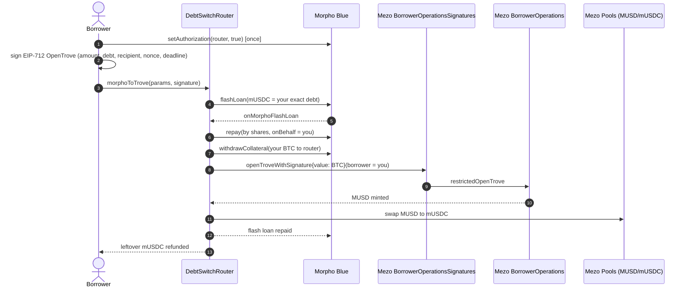
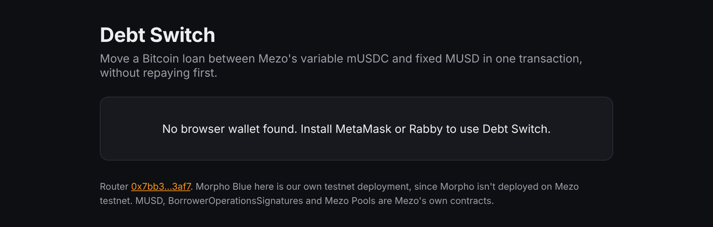
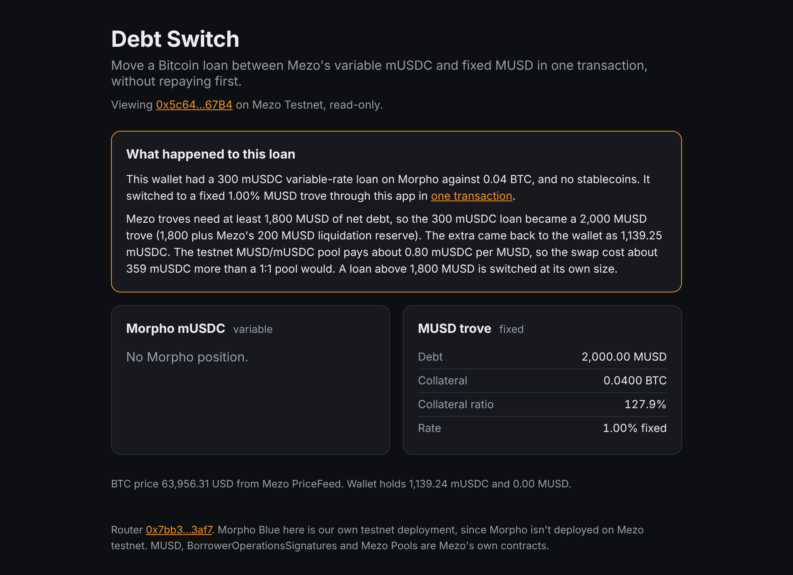
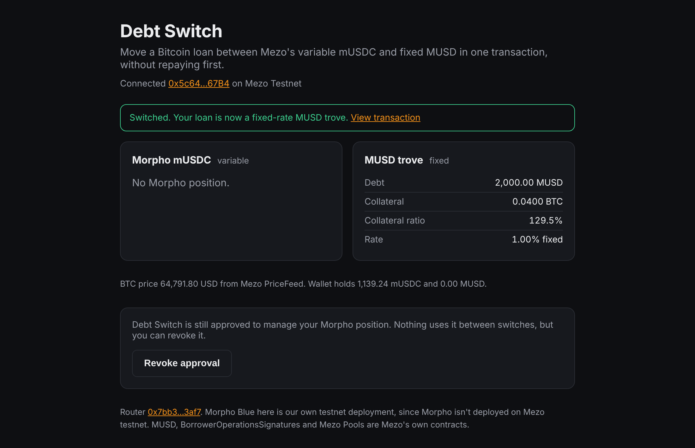
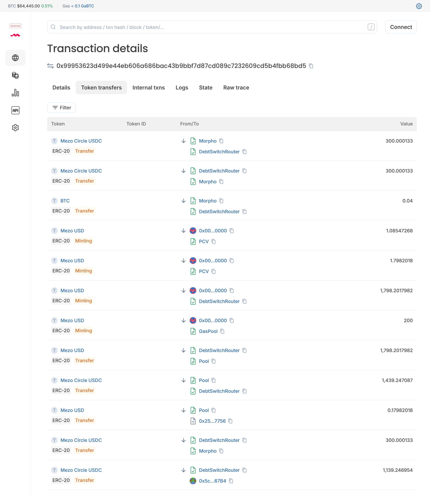
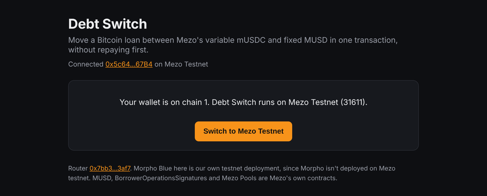
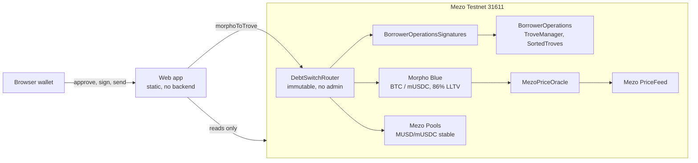

<div align="center">

# Debt Switch

### Switch a Bitcoin loan on Mezo between variable mUSDC and fixed MUSD in one transaction, without repaying first.

[](https://debtswitch.midelabs.xyz)
[](https://explorer.test.mezo.org/address/0x7bb308048C4C511A4102640eDCD8027c22123af7)
[](#tracks)
[](test)
[](#contracts)
[](LICENSE)

**[Live app](https://debtswitch.midelabs.xyz)** · **[See a switched loan, no wallet needed](https://debtswitch.midelabs.xyz/?address=0x5c64aCAa8AB6AE0b9386afF5339C23CE54E067B4)** · **[Judge guide](JUDGE.md)** · **[Deck](docs/Debt-Switch-deck.pdf)** · **[The switch on the explorer](https://explorer.test.mezo.org/tx/0x99953623d499e44eb606a686bac43b9bbf7d87cd089c7232609cd5b4fbb68bd5)** · **[Router contract](https://explorer.test.mezo.org/address/0x7bb308048C4C511A4102640eDCD8027c22123af7?tab=contract)**

</div>

---

## At a glance

**Who it's for, on Mezo mainnet today.** Read directly from Mezo mainnet at block 13,240,656 (Nov 15, 2026, 07:57 UTC):

| Mezo mainnet | Value |
|---|---|
| Morpho BTC/mUSDC market, borrowed | **42,107 mUSDC** of 55,923 supplied (75% utilised) |
| Its variable borrow rate | **2.23% APY** |
| MUSD trove fixed rate | **1.00%** |
| Active BTC/mUSDC borrowers | 7, of whom **2 owe more than the 1,800 MUSD trove minimum**. Those 2 hold 42,100 mUSDC, 99.98% of the market's debt (39,881 and 2,219). |
| MUSD troves | 4, with 28,310 MUSD of debt |
| MUSD/mUSDC pool depth | About **4,620 mUSDC** against 6,173 MUSD |

The demand is real but concentrated. Almost all of the market's debt sits above the trove minimum and pays 2.23% variable against MUSD's 1.00% fixed. What limits switching on mainnet today is the depth of the MUSD/mUSDC pool, not the contract. 2,000 MUSD swaps at 0.92 mUSDC per MUSD, and 6,000 MUSD at 0.61, so only switches of a few thousand mUSDC clear today. Moving the 39,881 mUSDC position needs a deeper MUSD/mUSDC pool or routing across several pools ([milestones](#future-milestones)). Every switch that clears pulls Morpho debt into MUSD. Reproduce these numbers with [`script/mainnet-market-stats.sh`](script/mainnet-market-stats.sh).

**What the demo shows.** On testnet, a borrower with a 300 mUSDC Morpho loan and no stablecoins switched into a 1.00% fixed MUSD trove [in one transaction](https://explorer.test.mezo.org/tx/0x99953623d499e44eb606a686bac43b9bbf7d87cd089c7232609cd5b4fbb68bd5?tab=token_transfers). Two testnet facts shape the numbers:

- **Mezo's 1,800 MUSD minimum.** A 300 mUSDC loan can't become a 300 MUSD trove, so the trove was sized to the minimum (2,000 MUSD including Mezo's 200 MUSD liquidation reserve) and the extra 1,139.25 mUSDC went back to the borrower. A loan above 1,800 switches at its own size.
- **An unbalanced testnet pool.** The testnet MUSD/mUSDC pool pays about 0.80 mUSDC per MUSD, so the swap cost about 359 mUSDC more than a balanced pool would.

---

## Contents

[At a glance](#at-a-glance) · [The problem](#the-problem) · [The solution](#the-solution) · [Judge path](#judge-path) · [Tracks](#tracks) · [How it works](#how-it-works) · [Mezo integration](#mezo-integration-what-is-load-bearing) · [Screens](#screens) · [Proof](#proof-on-mezo-testnet) · [Security](#security) · [What we built](#what-we-built) · [Built with](#built-with) · [Submission details](#submission-details) · [Judging criteria](#how-debt-switch-maps-to-the-judging-criteria) · [Run it](#run-it-locally) · [Limits](#limits) · [About](#about)

---

## The problem

Mezo gives a Bitcoin holder two ways to borrow against their BTC, and they behave very differently:

| | **Morpho mUSDC** | **MUSD trove** |
|---|---|---|
| Rate | Variable, set by market utilisation | Fixed when the trove opens |
| Mainnet quote on 0.20 BTC, Nov 14, 2026 | 2.4% | 1.0%, plus a 0.10% issuance fee |
| Liquidation threshold | 86% LTV | 90% LTV |
| Minimum size | None | 1,800 MUSD net debt, plus a 200 MUSD liquidation reserve |
| Collateral | BTC | BTC |

Picking one is easy. **Changing your mind is not.** Today, a borrower who wants the other product's terms has to:

1. Find enough stablecoins to repay the whole loan, usually money they don't have.
2. Repay, withdraw the BTC, then open the other product from scratch.

So borrowers stay where they first landed, even when rates move against them or they drift close to Morpho's 86% liquidation line while a trove would give them room up to 90%. Mezo's two borrowing products sit side by side with no path between them.

## The solution

Debt Switch moves a whole loan from Morpho mUSDC into an MUSD trove in **one atomic transaction**, and the borrower's wallet needs **zero stablecoins**.

- **One approval, one signature, one transaction.**
- The new trove is opened **in the borrower's own name** through Mezo's own signed-delegation contract. The router never owns it.
- **All or nothing.** If any step fails, everything reverts and the original loan is untouched.
- **The router keeps nothing.** It ends every transaction with zero BTC, zero MUSD and zero mUSDC.
- **No backend, no admin key, no token.** One immutable contract and a static web app that reads everything from chain.

## Judge path

The full walkthrough with expected results is in **[JUDGE.md](JUDGE.md)**. The short version, about 3 minutes:

1. Open **[the switch transaction](https://explorer.test.mezo.org/tx/0x99953623d499e44eb606a686bac43b9bbf7d87cd089c7232609cd5b4fbb68bd5?tab=token_transfers)** and read the token transfers top to bottom. That one transaction shows the flash loan, the Morpho repayment, the BTC moving, MUSD minted by Mezo, the swap, the flash loan repaid and the refund.
2. Open **[the demo borrower in the app](https://debtswitch.midelabs.xyz/?address=0x5c64aCAa8AB6AE0b9386afF5339C23CE54E067B4)**. No wallet needed. It reads that wallet's Morpho position and trove live from chain and explains the switch. With your own wallet on Mezo Testnet, [the app](https://debtswitch.midelabs.xyz) reads your positions the same way.
3. Check the refusals on chain: a [below-floor attempt](https://explorer.test.mezo.org/tx/0xaf9e00b1c6f240869b02960e8a8bb5314a41b35a3aeab391331c7091a7f1e027) and a [wrong-caller attempt](https://explorer.test.mezo.org/tx/0xc3d1628ca463dd13b0e4d293d32fc449d519897ac50ac14b7a0e2a68a88b45c8), both reverted.
4. Read the [verified router source](https://explorer.test.mezo.org/address/0x7bb308048C4C511A4102640eDCD8027c22123af7?tab=contract), 172 lines.

## Tracks

**Track 1: DeFi (Borrowing, Lending, Looping, and Yield).**

The track asks how to expand MUSD utility as collateral and productive capital across DeFi. Debt Switch adds a new on-ramp into MUSD borrowing. Any Morpho mUSDC borrower on Mezo can move into an MUSD trove without new capital, which turns existing variable-rate debt into MUSD debt. It plugs into existing lending infrastructure (Morpho Blue, Mezo's trove system, Mezo Pools) instead of building a new isolated app.

## How it works



Step by step, inside one transaction:

| # | Step | Contract | Why it is needed |
|---|---|---|---|
| 1 | Flash-borrow the exact mUSDC debt | Morpho Blue | Pays the old loan without the borrower's own cash. Free on Morpho. |
| 2 | Repay the borrower's Morpho debt **by shares** | Morpho Blue | Repaying by shares clears interest to the last wei, so no dust is left. |
| 3 | Withdraw the borrower's BTC to the router | Morpho Blue | Needs the borrower's one-time `setAuthorization`. |
| 4 | Open a trove for the borrower with that BTC | Mezo `BorrowerOperationsSignatures` | The borrower's EIP-712 signature lets the router open a trove **in their name**. |
| 5 | Swap the new MUSD to mUSDC | Mezo Pools stable pool | Turns trove debt back into the asset owed to the flash loan. |
| 6 | Morpho pulls the flash loan back | Morpho Blue | If the swap came up short, everything reverts. |
| 7 | Refund leftovers to the borrower | Router | Router ends at zero balances. |

**Why BTC can move this way on Mezo:** Mezo's BTC is both the chain's native coin and an ERC-20 at `0x7b7C...0000`, sharing one balance. Morpho hands the router BTC as an ERC-20, and the router passes the same BTC to Mezo's trove contract as native value. We proved this on live testnet before building anything else ([tx](https://explorer.test.mezo.org/tx/0x5cce5c66b31ece55b21d793b4e69b0e2be4cab52e89304594f1dc9c7779f35b0)).

**About the 1,800 MUSD floor:** a Mezo trove must carry at least 1,800 MUSD of net debt. If the Morpho loan is smaller, the trove is sized to the floor and the extra mUSDC from the swap is refunded to the borrower. The demo switch shows this: a 300 mUSDC Morpho loan became a 2,000 MUSD trove (1,800 net plus the 200 reserve), and the borrower received 1,139.25 mUSDC back.

## Mezo integration: what is load-bearing

Every Mezo component below sits inside the switch transaction. Take any one away and the switch cannot happen.

| Mezo component | Testnet address | Where we use it | What breaks without it |
|---|---|---|---|
| **MUSD** | `0x1189...c503` | Minted into the router when the trove opens, then swapped ([router L148-155](contracts/DebtSwitchRouter.sol#L148-L155)) | There is nothing to switch into. MUSD is the destination debt. |
| **BorrowerOperationsSignatures** | `0xD757...7D639e` | `openTroveWithSignature` opens the trove in the borrower's name ([router L148](contracts/DebtSwitchRouter.sol#L148)). The app signs Mezo's EIP-712 `OpenTrove` message ([main.ts L182](app/src/main.ts#L182)) and reads `getNonce`. | The router could only open a trove for itself, not for the user. This is Mezo's own delegation primitive. |
| **BorrowerOperations** | `0xCdF7...beE5` | `minNetDebt` and `getBorrowingFee` power the router's floor check ([router L102-103](contracts/DebtSwitchRouter.sol#L102-L103)) and the app's trove sizing | No floor check, no fee-correct sizing. Mezo itself enforces the floor and the collateral ratio. |
| **TroveManager / SortedTroves / HintHelpers** | `0xE47c...6bb0` / `0x722E...68fA` / `0x4e4c...BCF6` | The app reads trove status, collateral, debt and rate, and computes insert hints ([chain.ts L101-125](app/src/chain.ts#L101-L125)) | Without hints the insert walks all 266 testnet troves and runs out of gas. We hit exactly that on a [live attempt](https://explorer.test.mezo.org/tx/0xe27a019f44ee2d1836a2b458579368d13bfcd557317191f3ebb5c2eeda09aebe). |
| **PriceFeed** | `0x86bC...9366` | Prices our Morpho market ([oracle L20](contracts/MezoPriceOracle.sol#L20)) and the app's collateral ratio and liquidation price | Morpho and MUSD would price BTC differently, and the preview couldn't show a trusted liquidation price. |
| **InterestRateManager** | `0xD4D6...7f37` | The app shows the fixed rate a new trove gets | The user wouldn't see the rate they're switching into. |
| **Mezo Pools MUSD/mUSDC stable pool** | Router `0x9a1f...D7E9`, pool `0x525F...Dc3e` | Swaps the minted MUSD into mUSDC to repay the flash loan ([router L155](contracts/DebtSwitchRouter.sol#L155)). The app quotes it with `getAmountsOut`. | The flash loan couldn't be repaid, so there would be no atomic switch. |
| **BTC (native and ERC-20)** | `0x7b7C...0000` | Collateral in both products, moved between them in one transaction | Nothing to move. |
| **mUSDC** | `0xe1a2...3a59` | The Morpho loan asset and the flash-loan asset | The source debt. |

Full addresses are in [`deployments/31611.json`](deployments/31611.json).

## Screens

### 1. Connect



The app opens on a single action. It works with any injected browser wallet (MetaMask, Rabby). There is no account system and no backend.

### 2. Read-only view, no wallet needed



Add `?address=` and any testnet address to the app URL to see that wallet's live positions without connecting. [This link](https://debtswitch.midelabs.xyz/?address=0x5c64aCAa8AB6AE0b9386afF5339C23CE54E067B4) opens the demo borrower. The orange card explains how Mezo's 1,800 MUSD minimum and the unbalanced testnet pool shaped the switch. Below it, the trove card shows the live result from Mezo's TroveManager. The connect screen links here, so anyone can see the product working without a funded wallet.

### 3. After the switch, in the borrower's own wallet



This is the real demo borrower `0x5c64...67B4` right after switching through the app:

- **Green banner:** the transaction confirmed, with a link to it on the explorer.
- **Morpho mUSDC card:** "No Morpho position." The 300 mUSDC loan is fully repaid and the 0.04 BTC is gone from Morpho.
- **MUSD trove card:** 2,000.00 MUSD of debt, 0.0400 BTC collateral, a 129.5% collateral ratio and a **1.00% fixed** rate. Every value comes from Mezo's TroveManager.
- **Summary line:** the BTC price comes live from Mezo's PriceFeed. The wallet holds the 1,139.24 mUSDC refund and 0 MUSD.
- **Revoke card:** the app reminds the user that the router still holds Morpho permission and offers a one-click revoke. We used it: [revoke tx](https://explorer.test.mezo.org/tx/0xdc4a1b45dfec0e4a24eea00064e255898d9603464c2eed17408b9af736adce2b).

Before the switch, the same screen shows a preview card built entirely from chain reads: the Morpho debt to repay, the BTC to move, the new trove debt, the issuance fee, the 200 MUSD reserve, the fixed rate, the live swap quote with your slippage minimum, the expected refund, the new collateral ratio, the liquidation price, a note when the 1,800 MUSD floor sizes the trove, and a note with the pool's live rate when it's far from 1:1. If the switch would fail, the preview lists the reason and the button stays disabled.

### 4. The switch on the explorer



The token transfers of [the switch transaction](https://explorer.test.mezo.org/tx/0x99953623d499e44eb606a686bac43b9bbf7d87cd089c7232609cd5b4fbb68bd5?tab=token_transfers), read top to bottom:

1. **300.000133 mUSDC, Morpho to DebtSwitchRouter.** The flash loan.
2. **300.000133 mUSDC, DebtSwitchRouter to Morpho.** The borrower's Morpho debt repaid, including interest.
3. **0.04 BTC, Morpho to DebtSwitchRouter.** The collateral withdrawn.
4. **MUSD minted to PCV.** Mezo's protocol-owned share, including the 1.798 MUSD issuance fee.
5. **1,798.2017982 MUSD minted to DebtSwitchRouter.** The new trove debt, opened in the borrower's name.
6. **200 MUSD minted to GasPool.** Mezo's liquidation reserve for the trove.
7. **1,798.2017982 MUSD, router to Pool,** then **1,439.247087 mUSDC, Pool to router.** The Mezo Pools swap. A 0.18 MUSD swap fee goes to the pool's fee address.
8. **300.000133 mUSDC, router to Morpho.** The flash loan repaid.
9. **1,139.246954 mUSDC, router to the borrower.** The refund. The router is left with nothing.

### 5. Wrong network guard



On any chain other than Mezo Testnet, the app blocks every action and offers one button that switches the wallet to chain 31611, adding the network if the wallet doesn't know it.

The app also has dedicated states for no wallet installed, loading, read errors with retry, a wallet with no Mezo loan (with a link to Mezo), in-progress steps with transaction links, and readable revert reasons.

## Proof on Mezo Testnet

| What happened | Transaction |
|---|---|
| A contract moves BTC native to ERC-20 and back (the key assumption, proven first) | [`0x5cce5c66...`](https://explorer.test.mezo.org/tx/0x5cce5c66b31ece55b21d793b4e69b0e2be4cab52e89304594f1dc9c7779f35b0) |
| Morpho Blue deployed | [`0xcbeff78b...`](https://explorer.test.mezo.org/tx/0xcbeff78b37c2945f88549eb1321754995342e7f6057bfa40c0dd7f8e2ccefd23) |
| BTC/mUSDC market created | [`0x7afc5e41...`](https://explorer.test.mezo.org/tx/0x7afc5e418c0eb22b14d497d8f406977d6b61b4eccefbf181106c29adc98250cf) |
| DebtSwitchRouter deployed | [`0x3cb46f42...`](https://explorer.test.mezo.org/tx/0x3cb46f4204cbc35d963da1984d745e8ee612e724eea641b26cd719055dd5febf) |
| Demo borrower opens a 300 mUSDC Morpho loan on 0.04 BTC | [`0x60c5842d...`](https://explorer.test.mezo.org/tx/0x60c5842d1d22b4e009bad481a0bd8172c781ac1a8c217705ac99067a6a48356c) |
| Borrower approves the router on Morpho through the app | [`0xf3f676b4...`](https://explorer.test.mezo.org/tx/0xf3f676b46ab60f116095e5bf9661d2b0cdcdb6254d215b4665a7ba016d65169b) |
| **The switch, through the app** | [**`0x99953623...`**](https://explorer.test.mezo.org/tx/0x99953623d499e44eb606a686bac43b9bbf7d87cd089c7232609cd5b4fbb68bd5) |
| Borrower revokes the router through the app | [`0xdc4a1b45...`](https://explorer.test.mezo.org/tx/0xdc4a1b45dfec0e4a24eea00064e255898d9603464c2eed17408b9af736adce2b) |

State after the switch, readable by anyone:

```bash
# Trove status for the demo borrower: 1 = active
cast call 0xE47c80e8c23f6B4A1aE41c34837a0599D5D16bb0 "getTroveStatus(address)(uint8)" \
  0x5c64aCAa8AB6AE0b9386afF5339C23CE54E067B4 --rpc-url https://rpc.test.mezo.org

# Morpho position for the same borrower: 0 supply, 0 borrow shares, 0 collateral
cast call 0x9074F3348585bECdde74fa1c0DE0722043F9f76e "position(bytes32,address)(uint256,uint128,uint128)" \
  0x19e8401c76f050f4aeb9d145c4f6d2cde9dbba187cd180353018637d261ee541 \
  0x5c64aCAa8AB6AE0b9386afF5339C23CE54E067B4 --rpc-url https://rpc.test.mezo.org
```

These are testnet transactions from a demo wallet we funded. They prove the mechanism. They aren't third-party usage.

## Security

| Attempt | Result | Evidence |
|---|---|---|
| Open a trove below Mezo's 1,800 MUSD floor | Reverts `BelowMinNetDebt(1001e18, 1800e18)` | [On-chain revert](https://explorer.test.mezo.org/tx/0xaf9e00b1c6f240869b02960e8a8bb5314a41b35a3aeab391331c7091a7f1e027), `test_RevertWhen_BelowMinNetDebt` |
| Someone else triggers your switch | Reverts `NotBorrower()` | [On-chain revert](https://explorer.test.mezo.org/tx/0xc3d1628ca463dd13b0e4d293d32fc449d519897ac50ac14b7a0e2a68a88b45c8), `test_RevertWhen_CallerNotBorrower` |
| The swap returns less than your minimum | Reverts with Mezo Pools' `InsufficientOutputAmount()` | `test_RevertWhen_SlippageExceeded` |
| Replay a trove signature that was already used | Mezo rejects it: "Invalid signature" (nonce moved on) | `test_RevertWhen_SignatureReplayed` |
| Call the flash-loan callback directly | Reverts `NotMorpho()` | `test_RevertWhen_CallbackNotFromMorpho` |
| Switch after 30 days of accrued interest | Debt cleared by shares, no dust left | `test_ClosesFullyAfterAccrual` |
| The router keeps funds | Zero BTC, MUSD and mUSDC after every switch | `test_RouterHoldsNothing`, on-chain read |
| The transaction runs out of gas halfway | Everything reverts, the position is untouched | [On-chain revert](https://explorer.test.mezo.org/tx/0xe27a019f44ee2d1836a2b458579368d13bfcd557317191f3ebb5c2eeda09aebe) |

Design choices behind these:

- `msg.sender` must be the borrower named in the parameters. The callback only runs for Morpho, and only while a switch is in progress.
- The trove signature binds the BTC amount, the debt, the recipient (the router), the nonce and a deadline. Mezo checks all of them.
- The router is immutable, with no owner, no upgrade path and no stored funds. It approves only Morpho (for mUSDC) and the Mezo Pools router (for MUSD), and holds nothing between transactions.
- The app simulates every switch before asking you to sign it, and decodes reverts from the router, Mezo and Mezo Pools into plain sentences.

**Testing approach.** The tests run on a fork of Mezo Testnet with Mezo's real deployed MUSD, BorrowerOperations, BorrowerOperationsSignatures, TroveManager and Mezo Pools. Mezo's BTC token and BTC/USD oracle are built into the chain, so a fork can't execute them. The tests replace those two with clearly labelled stand-ins in [`test/standins`](test/standins): one mirrors BTC's shared native and ERC-20 balance, the other serves the live oracle price fetched over RPC. The stand-ins are never deployed, and the live transactions above use the real ones.

## What we built

| Component | What it is | Lines |
|---|---|---|
| [`contracts/DebtSwitchRouter.sol`](contracts/DebtSwitchRouter.sol) | The immutable router: `morphoToTrove` plus the Morpho flash-loan callback | 172 |
| [`contracts/MezoPriceOracle.sol`](contracts/MezoPriceOracle.sol) | A Morpho oracle that prices BTC in mUSDC from Mezo's PriceFeed (`price = p1e18 × 1e6`) | 22 |
| [`contracts/interfaces/IMezo.sol`](contracts/interfaces/IMezo.sol) | Minimal interfaces for Mezo's trove contracts and Mezo Pools | 54 |
| [`app/`](app) | A static single-page app in TypeScript and viem: live reads, preview, approve, sign, simulate, submit, re-read, revoke | 765 |
| [`test/`](test) | Fork tests and an oracle fuzz test, 10 in total | 367 |
| [`script/Deploy.s.sol`](script/Deploy.s.sol) | Deploys Morpho Blue, the interest rate model, the oracle, the market and the router | 66 |
| [`script/seed-market.sh`](script/seed-market.sh) | Seeds market liquidity through Mezo Pools and opens the demo borrower's loan | 54 |
| [`script/negative-proofs.sh`](script/negative-proofs.sh) | Sends the refused switches on chain and asserts each one reverts | 39 |
| [`script/btc-roundtrip.sh`](script/btc-roundtrip.sh), [`contracts/BtcHop.sol`](contracts/BtcHop.sol) | The first live proof that BTC can hop between native and ERC-20 form inside a contract | 81 |
| [`app/e2e/live-switch.mjs`](app/e2e/live-switch.mjs) | A Playwright harness that drives the real app on testnet with a test wallet | 94 |
| [`Dockerfile`](Dockerfile) | Static build served by nginx, deployed with Dokploy | 13 |

What we reused, unmodified: **Morpho Blue v1.0.0** and **AdaptiveCurveIrm v1.0.0**. Morpho Blue isn't deployed on Mezo Testnet, so we deployed our own instance with an 86% LLTV to match Mezo mainnet's mUSDC market.

## Built with

| Layer | Tools |
|---|---|
| Chain | Mezo Testnet (31611), MUSD, BTC, Mezo PriceFeed, Mezo Pools |
| Contracts | Solidity 0.8.24 (router, oracle), Solidity 0.8.19 (Morpho Blue), Foundry 1.9.0 (forge, cast, anvil) |
| Lending | Morpho Blue v1.0.0, AdaptiveCurveIrm v1.0.0 |
| Frontend | TypeScript 5.9, viem 2.57, Vite 8, no UI framework |
| Testing | Forge fork tests and fuzzing, Playwright end-to-end against live testnet |
| Verification | Blockscout source verification on the Mezo testnet explorer |
| Hosting | Docker (nginx), Dokploy, Cloudflare DNS, Let's Encrypt |

### Architecture



## Contracts

All four of our contracts are source-verified on the Mezo testnet explorer.

| Contract | Address |
|---|---|
| DebtSwitchRouter | [`0x7bb308048C4C511A4102640eDCD8027c22123af7`](https://explorer.test.mezo.org/address/0x7bb308048C4C511A4102640eDCD8027c22123af7?tab=contract) |
| Morpho Blue (our deployment) | [`0x9074F3348585bECdde74fa1c0DE0722043F9f76e`](https://explorer.test.mezo.org/address/0x9074F3348585bECdde74fa1c0DE0722043F9f76e?tab=contract) |
| AdaptiveCurveIrm | [`0x50E828C8Ca6e0EE5c355179A1a8b20Cce943373d`](https://explorer.test.mezo.org/address/0x50E828C8Ca6e0EE5c355179A1a8b20Cce943373d?tab=contract) |
| MezoPriceOracle | [`0x101764Ed730a37f39B80DCe97882bdff76be24c9`](https://explorer.test.mezo.org/address/0x101764Ed730a37f39B80DCe97882bdff76be24c9?tab=contract) |
| BTC/mUSDC market id | `0x19e8401c76f050f4aeb9d145c4f6d2cde9dbba187cd180353018637d261ee541` |

## Submission details

| Field | Answer |
|---|---|
| Project name | Debt Switch |
| Category | Borrowing, debt refinancing |
| TL;DR | Switch a Bitcoin loan on Mezo from variable Morpho mUSDC to a fixed-rate MUSD trove in one transaction, without repaying first. |
| How it works | A Morpho flash loan repays the borrower's mUSDC debt, their BTC opens an MUSD trove in their name through Mezo's `openTroveWithSignature`, and the new MUSD is swapped on Mezo Pools to repay the flash loan, all atomically. MUSD is the destination debt, minted by Mezo inside the switch. See [How it works](#how-it-works). |
| Target group | Bitcoin holders who already borrow on Mezo and want the other product's terms: fixed-rate certainty, or the 90% liquidation threshold instead of 86%. On mainnet today that's the Morpho BTC/mUSDC market, where 2 borrowers above the 1,800 MUSD minimum hold 42,100 mUSDC at 2.23% variable. Switch size on mainnet is limited by MUSD/mUSDC pool depth. Experienced DeFi users on desktop with a browser wallet. Global. |
| Track | Track 1: DeFi (Borrowing, Lending, Looping, and Yield) |
| Chain | Mezo Testnet (31611) |
| Project status | Entirely new, built during Wave 2 |
| Readiness | Testnet deployment, live app at [debtswitch.midelabs.xyz](https://debtswitch.midelabs.xyz), with a [read-only demo view](https://debtswitch.midelabs.xyz/?address=0x5c64aCAa8AB6AE0b9386afF5339C23CE54E067B4) |
| Live link | https://debtswitch.midelabs.xyz |
| Repository | https://github.com/mystiquemide/debt-switch |
| Deck | [docs/Debt-Switch-deck.pdf](docs/Debt-Switch-deck.pdf) |
| Tech stack | Solidity, Foundry, Morpho Blue, viem, TypeScript, Vite, Playwright, Docker. See [Built with](#built-with). |
| Team | MystiqueMide, founder. Built everything: product, contracts, app, testing and deployment. |

### Future milestones

| Milestone | What ships | Target |
|---|---|---|
| 1. Multi-pool routing | Route the MUSD-to-mUSDC leg across several Mezo pools (MUSD/mUSDC, MUSD/mUSDT, MUSD/BTC) so larger loans clear mainnet liquidity | December 2026 |
| 2. Reverse switch | `troveToMorpho`: close a trove with `closeTroveWithSignature` and move the BTC into Morpho, with the same atomic guarantees | January 2027 |
| 3. Mainnet | Audit, then deploy against Mezo's own mainnet Morpho BTC/mUSDC market (`0x6f88e79e...33db` on Morpho `0x5658...a311`), with partial switches | Q1 2027 |

## How Debt Switch maps to the judging criteria

| Criterion | Weight | Where to look |
|---|---|---|
| Mezo Integration | 30% | MUSD is minted inside the switch through Mezo's own `openTroveWithSignature`, sized by `minNetDebt` and `getBorrowingFee`, priced by Mezo's PriceFeed, inserted with HintHelpers, and settled through Mezo Pools. See [Mezo integration](#mezo-integration-what-is-load-bearing). |
| Product & Business Viability | 30% | It answers the Track 1 question directly: it adds a route from existing variable-rate debt into MUSD, using only Mezo's existing products. On mainnet, 99.98% of the Morpho BTC/mUSDC market's debt sits above the trove minimum and pays 2.23% variable against 1.00% fixed. Pool depth caps switch size today, and that's addressed in the milestones. See [At a glance](#at-a-glance). |
| Technical Implementation | 20% | An immutable, atomic router with zero retained balances. Fork tests against live Mezo contracts, on-chain refusals, source-verified contracts. See [Security](#security). |
| User Experience | 10% | One approval, one signature, one transaction. A live preview with block reasons, decoded errors, a network guard, one-click revoke, and a read-only view anyone can open without a wallet. See [Screens](#screens). |
| Submission Materials | 10% | This README, [JUDGE.md](JUDGE.md), the [deck](docs/Debt-Switch-deck.pdf), the live app and the pitch video. |

## Run it locally

```bash
git clone --recurse-submodules https://github.com/mystiquemide/debt-switch && cd debt-switch
forge test                              # 10 tests on a fork of Mezo Testnet
cd app && npm install && npm run dev    # the web app on localhost
```

Requirements: [Foundry](https://getfoundry.sh) and Node 22.

`foundry.toml` pins `evm_version = "shanghai"` because Mezo's block headers have no blob gas fields, which newer EVM versions expect when forking. Deploy and proof scripts read private keys from files outside the repo, for example `DEPLOYER_KEY_FILE=path/to/testnet.key`.

```text
contracts/    DebtSwitchRouter, MezoPriceOracle, Mezo interfaces, BtcHop
test/         fork tests and test-only stand-ins for Mezo's native BTC and oracle
script/       deploy, market seeding, live BTC and refusal proofs
app/          the web app and its end-to-end harness
deployments/  every testnet address
docs/         screenshots
```

## Limits

- **Unaudited.** Tests and live testnet runs aren't an audit. Don't use this with real funds.
- **Testnet only.** The Morpho Blue instance is ours. Mezo testnet has no official Morpho deployment.
- **One direction.** Morpho to MUSD is live. MUSD to Morpho is milestone 2.
- **Whole positions only.** Partial switches come with mainnet (milestone 3).
- **The 1,800 MUSD floor.** Morpho loans under the floor become an 1,800 MUSD trove, and the extra comes back as mUSDC.
- **Pool depth.** The testnet MUSD/mUSDC pool trades around 0.80 mUSDC per MUSD. The mainnet pool holds about 4,620 mUSDC, so mainnet switches above a few thousand mUSDC need multi-pool routing (milestone 1).
- **Two refusals are proven in tests only.** Slippage and signature replay haven't been sent on chain. That needs a fresh 0.045 BTC Morpho position, and the testnet faucet limited us to 0.05 BTC.
- **Morpho permission.** The router's Morpho permission stays on until you revoke it. The app offers the revoke right after a switch.

## About

Debt Switch was founded and built end to end by **MystiqueMide** for Wave 2 of the Mezo Buildathon on AKINDO.

The idea came from looking at Mezo's two borrowing products side by side. Both take the same BTC, but nothing connects them, so the only way across is to repay in full. Morpho's free flash loans and Mezo's signed trove delegation made it possible to bridge them in one transaction without the router ever owning anyone's position.

## License

[GPL-2.0-or-later](LICENSE). Includes Morpho Blue v1.0.0, which moved from BUSL-1.1 to GPL-2.0-or-later on its change date, and AdaptiveCurveIrm v1.0.0 (MIT).
