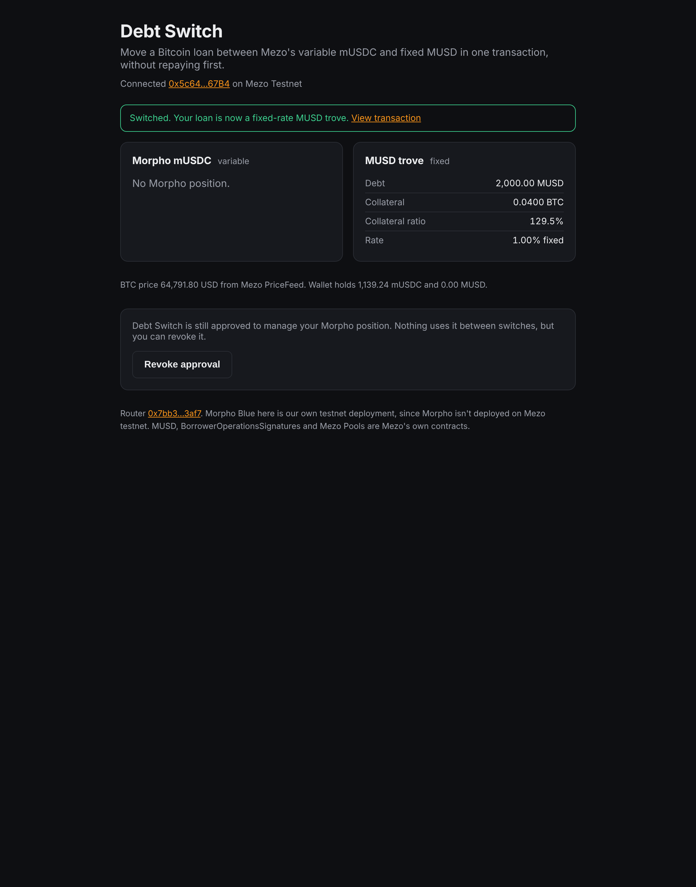
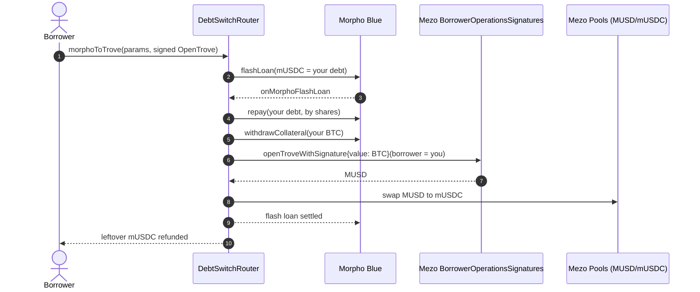
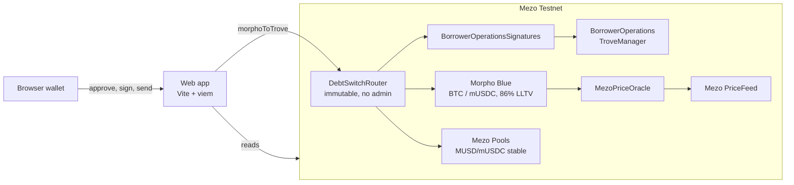

<div align="center">

# Debt Switch

**Switch a Bitcoin loan on Mezo between variable mUSDC and fixed MUSD in one transaction, without repaying first.**

[](https://debtswitch.midelabs.xyz)
[](https://explorer.test.mezo.org/address/0x7bb308048C4C511A4102640eDCD8027c22123af7)
[](test)
[](https://explorer.test.mezo.org/address/0x7bb308048C4C511A4102640eDCD8027c22123af7?tab=contract)
[](LICENSE)

[Live app](https://debtswitch.midelabs.xyz) · [Switch transaction](https://explorer.test.mezo.org/tx/0x99953623d499e44eb606a686bac43b9bbf7d87cd089c7232609cd5b4fbb68bd5) · [Router contract](https://explorer.test.mezo.org/address/0x7bb308048C4C511A4102640eDCD8027c22123af7)



</div>

---

## Why

Mezo lets you borrow against Bitcoin two ways:

| | Morpho mUSDC | MUSD trove |
|---|---|---|
| Rate | Variable (2.4% on a 0.20 BTC mainnet quote, Nov 14, 2026) | Fixed (1.0% on the same quote) |
| Liquidates at | 86% LTV | 90% LTV |
| Minimum | None | 1,800 MUSD net debt |

Picking one is easy. Changing your mind isn't. Moving today means repaying the whole loan in cash you probably don't have, then borrowing again. One Mezo user summed up the trove side: *"the only way out is to buy it all back and repay."*

Debt Switch does the whole move in a single atomic transaction. Your wallet needs no stablecoins at all.

## How it works



1. **Approve once.** You let the router act on your Morpho position. You can revoke it in the app afterwards.
2. **Sign once.** You sign Mezo's own EIP-712 `OpenTrove` message. It binds the BTC amount, the debt, the recipient, your nonce and a deadline.
3. **Send once.** The router flash-borrows mUSDC, clears your Morpho loan, moves your BTC into a new trove in your name, swaps the minted MUSD back to mUSDC and repays the flash loan.

If any step fails, the whole transaction reverts and your position stays as it was. The router never holds anything between transactions.

## Architecture



- **No backend.** Every number in the app comes from a chain read: Morpho position, trove state, PriceFeed, issuance fee, pool quote, signature nonce.
- **No admin.** The router has no owner, no upgrade path and no stored balances.
- **Mezo-native.** The trove is opened through Mezo's own signed delegation, so it belongs to you from the first block. Insert hints come from Mezo's HintHelpers.

## Proof on Mezo Testnet

| What | Transaction |
|---|---|
| Borrower opens a 300 mUSDC Morpho loan on 0.04 BTC | [`0x60c5842d...`](https://explorer.test.mezo.org/tx/0x60c5842d1d22b4e009bad481a0bd8172c781ac1a8c217705ac99067a6a48356c) |
| **Switch to a 1.00% fixed MUSD trove, through the app** | [`0x99953623...`](https://explorer.test.mezo.org/tx/0x99953623d499e44eb606a686bac43b9bbf7d87cd089c7232609cd5b4fbb68bd5) |
| Router approval revoked through the app | [`0xdc4a1b45...`](https://explorer.test.mezo.org/tx/0xdc4a1b45dfec0e4a24eea00064e255898d9603464c2eed17408b9af736adce2b) |
| Contract moves BTC between native and ERC-20 form | [`0x5cce5c66...`](https://explorer.test.mezo.org/tx/0x5cce5c66b31ece55b21d793b4e69b0e2be4cab52e89304594f1dc9c7779f35b0) |

After the switch, read straight from chain:

- Morpho position: 0 debt, 0 collateral
- Trove: active, 0.04 BTC, 2,000 MUSD, 1.00% fixed
- Router: 0 BTC, 0 MUSD, 0 mUSDC
- Borrower: started with 0 stablecoins, ended with 1,139.24 mUSDC refunded

```bash
cast call 0xE47c80e8c23f6B4A1aE41c34837a0599D5D16bb0 "getTroveStatus(address)(uint8)" \
  0x5c64aCAa8AB6AE0b9386afF5339C23CE54E067B4 --rpc-url https://rpc.test.mezo.org
# 1 = active
```

## Security

| Attempt | Result | Evidence |
|---|---|---|
| Open a trove below Mezo's 1,800 MUSD floor | `BelowMinNetDebt(1001, 1800)` | [on-chain revert](https://explorer.test.mezo.org/tx/0xaf9e00b1c6f240869b02960e8a8bb5314a41b35a3aeab391331c7091a7f1e027) · test |
| Switch someone else's position | `NotBorrower()` | [on-chain revert](https://explorer.test.mezo.org/tx/0xc3d1628ca463dd13b0e4d293d32fc449d519897ac50ac14b7a0e2a68a88b45c8) · test |
| Swap returns less than your minimum | `InsufficientOutputAmount()` | test |
| Replay a used trove signature | Mezo rejects: "Invalid signature" | test |
| Call the flash-loan callback directly | `NotMorpho()` | test |
| Switch after 30 days of interest | Debt cleared by shares, no dust | test |
| Router keeps funds | Zero balances after every switch | test · chain read |
| Transaction runs out of gas mid-switch | Everything reverts, position untouched | [on-chain revert](https://explorer.test.mezo.org/tx/0xe27a019f44ee2d1836a2b458579368d13bfcd557317191f3ebb5c2eeda09aebe) |

Tests run against a fork of Mezo testnet with Mezo's deployed MUSD, BorrowerOperations, TroveManager and Mezo Pools. See [`test/MorphoToTrove.fork.t.sol`](test/MorphoToTrove.fork.t.sol).

Mezo's BTC token and BTC/USD oracle are built into the chain, so a fork can't run them. The tests swap in two clearly marked stand-ins from [`test/standins`](test/standins). The stand-in BTC token mirrors native balances, and the stand-in oracle serves the live price. Neither is ever deployed, and the live transactions above use the real ones.

## Contracts

| Contract | Address |
|---|---|
| DebtSwitchRouter | [`0x7bb308048C4C511A4102640eDCD8027c22123af7`](https://explorer.test.mezo.org/address/0x7bb308048C4C511A4102640eDCD8027c22123af7) |
| Morpho Blue | [`0x9074F3348585bECdde74fa1c0DE0722043F9f76e`](https://explorer.test.mezo.org/address/0x9074F3348585bECdde74fa1c0DE0722043F9f76e) |
| AdaptiveCurveIrm | [`0x50E828C8Ca6e0EE5c355179A1a8b20Cce943373d`](https://explorer.test.mezo.org/address/0x50E828C8Ca6e0EE5c355179A1a8b20Cce943373d) |
| MezoPriceOracle | [`0x101764Ed730a37f39B80DCe97882bdff76be24c9`](https://explorer.test.mezo.org/address/0x101764Ed730a37f39B80DCe97882bdff76be24c9) |
| BTC/mUSDC market | `0x19e8401c76f050f4aeb9d145c4f6d2cde9dbba187cd180353018637d261ee541` |

All four are source-verified. Morpho isn't deployed on Mezo testnet, so this is our own unmodified Morpho Blue v1.0.0 instance, set to the same 86% LLTV as Mezo's mainnet mUSDC market. The Mezo contracts it talks to are listed in [`deployments/31611.json`](deployments/31611.json).

## Run it

```bash
git clone --recurse-submodules https://github.com/mystiquemide/debt-switch && cd debt-switch
forge test                              # fork tests against Mezo testnet
cd app && npm install && npm run dev    # web app on localhost
```

`foundry.toml` pins `evm_version = "shanghai"` because Mezo's block headers have no blob gas fields. Scripts read keys from files outside the repo, for example `DEPLOYER_KEY_FILE=path/to/testnet.key`.

```text
contracts/   DebtSwitchRouter, MezoPriceOracle, Mezo interfaces
test/        fork tests and test-only stand-ins
script/      deploy, market seeding, live proofs
app/         web app (Vite + viem)
deployments/ testnet addresses
```

## Limits

- **Unaudited.** Tests and live runs are not an audit. Testnet only.
- **One direction.** Morpho to MUSD is live. MUSD to Morpho is next.
- **Whole positions.** No partial switches yet.
- **The 1,800 MUSD floor.** A smaller Morpho loan becomes an 1,800 MUSD trove, and the difference comes back to you as mUSDC. The demo switch shows exactly that.
- **Testnet pool skew.** The testnet MUSD/mUSDC pool trades around 0.80, so testnet swaps look worse than mainnet.
- **Two proofs are fork-only.** Slippage and signature replay are proven in tests. Showing them on-chain needs more testnet BTC than the faucet allowed.

## Roadmap

- Reverse switch: trove to Morpho with `closeTroveWithSignature`
- Partial switches above the floor
- Mainnet, against Mezo's own Morpho market

## License

GPL-2.0-or-later. Includes Morpho Blue v1.0.0, which is now GPL-2.0-or-later after its BUSL change date, and AdaptiveCurveIrm (MIT).
